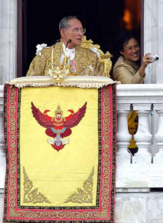

> After a while, His Majesty the King turned to take a critical look at Princess Sirindhorn's busy snapping away. The King said: "Shh ... can you take the pictures somewhere else?" via [The Nation[^src-historisch-1]]

Seit den Feierlichkeiten gingen schon auf meinen verschiedenen Thai-Mailinglisten Photos herum, auf denen man Prinzessin Maha Chakri Sirindhorn (สมเด็จพระเทพรัตนราชสุดา เจ้าฟ้ามหาจักรีสิรินธร รัฐสีมาคุณากรปิยชาติ สยามบรมราชกุมารี Som det phra thep phra rat raat cha su daa Chao fa Maha Chakri Sirindhorn Ratha si ma ku na korn pi ya chat Siam ba rom ma raat cha ku maa ree für die Titelfetischisten) hinter ihrem Vater König Bhumibol Adulyadej dem Großen Photos schießen sah --- aus beiden Richtungen, ihrer und der des Volkes. Ich fand das immer ein bisschen unverfroren, da der König ja Gottheitsstatus besitzt. Aber anscheinend mögen die Thais das trotzdem. Süß ist es ja auch.

Jedenfalls hält sie jetzt eine Ausstellung in Bangkok, auf der man ihre Bilder von den Feierlichkeiten betrachten kann. Ein weiterer Grund in den nächsten Tagen mal in den regnerischen Norden zu reisen.

<!-- cspell:ignore phra thep raat Ratha korn -->

[^src-historisch-1]: Historische Quelle: `http://www.nationmultimedia.com/2006/06/24/headlines/headlines_30007198.php`. Bei der Prüfung der Links am 27. November 2026 nicht erreichbar. Die ursprüngliche Adresse bleibt zur späteren Recherche erhalten.
